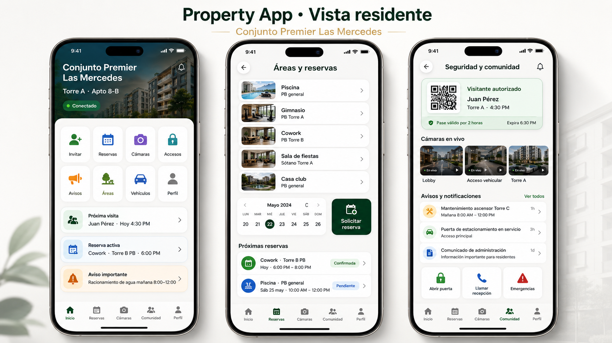

# Property Hub 0.9.0 — Property App conectada con datos reales

## Arquitectura

```text
Cuenta residente
  → persona local
  → relaciones con una o varias unidades
  → permisos por relación
  → Property App móvil/PWA
  → base real del Property Node
```

La aplicación no utiliza `DemoRepository` para una instalación productiva. Los datos provienen de las tablas operativas existentes.

## Flujo de configuración

1. Crear la estructura y el apartamento, casa, oficina o local.
2. Registrar la persona.
3. Vincularla con la unidad y habilitar los permisos necesarios.
4. En **Personas**, pulsar el icono de teléfono y crear la cuenta móvil.
5. En **Servicios y comunidad → Property App · Residentes**, configurar nombre, portada, color y funciones.
6. Probar la vista desde la consola o iniciar sesión desde un teléfono.

## Datos visibles

- Unidad activa y relación.
- Invitaciones creadas por esa persona y unidad.
- Reservas creadas por esa persona y unidad.
- Áreas activas y reservables.
- Cartelera publicada para residentes.
- Notificaciones dirigidas a la cuenta.
- Contactos de emergencia visibles.
- Cámaras autorizadas cuando la relación posee permiso.
- Puntos de acceso remotos cuando la relación posee permiso.

## Límites actuales

- La visualización de video sigue deshabilitada hasta implementar el gateway WebRTC/HLS.
- Los botones de apertura siguen deshabilitados hasta certificar el conector de acceso.
- Google y Apple autentican identidad, pero la vinculación automática con una persona local todavía requiere la siguiente fase.
- Los vehículos todavía no tienen CRUD persistente propio en la Property App.

## Referencia visual


